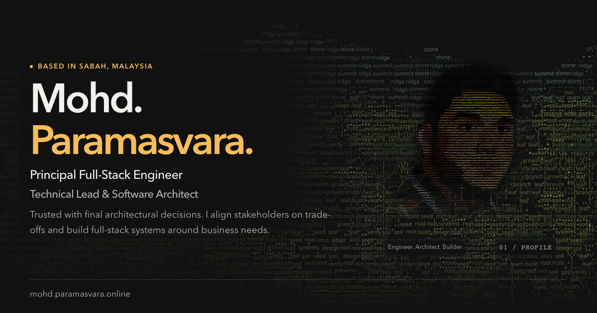

<a href="https://mohd.paramasvara.online/en/">
  
</a>

# Engineering with context. Evidence behind the decisions.

The source behind **[Mohd. Paramasvara’s engineering portfolio](https://mohd.paramasvara.online/en/)** — professional delivery, independent engineering case studies and interactive experiments, shaped by a Borneo-inspired visual identity.

[](https://github.com/MohdVara/mohdvara.github.io/actions/workflows/pages.yml)
[](LICENSE)

**[Visit the portfolio ↗](https://mohd.paramasvara.online/en/)** · [Professional work](https://mohd.paramasvara.online/en/#work) · [Work with me](https://mohd.paramasvara.online/en/work-with-me/) · [Résumé](https://rxresu.me/mwara95/2-page-resume) · [Contact](https://mohd.paramasvara.online/en/#contact)

## Start with the work

The portfolio connects problems, ownership and engineering decisions to the available evidence. Commercial case studies cover insurance quotation workflows, education-system modernization and HRMS integrations. Independent projects offer a closer look at source, architecture and verification.

| Case study | What to explore |
| --- | --- |
| **[MMCATS Modern](https://mohd.paramasvara.online/en/mmcats-modern/)** | Behavioral parity during Rails modernization: lifecycle contracts, authorization, private files and recovery. |
| **[PACE-RAG](https://mohd.paramasvara.online/en/pace-rag-case-study/)** | Cited cached answers, supported technology lookups and deliberate abstention. Start with a real source-bound example; live generative inference is disabled. |
| **[NAAE](https://mohd.paramasvara.online/en/naae/)** | Saved artwork comparisons, rendering architecture and reproducible configurations, with experimental boundaries made explicit. |
| **[No Two Mondays](https://mohd.paramasvara.online/en/no-two-mondays/)** | Simulation, presentation and persistence boundaries; save compatibility, bounded verification and a deeper historical archive. |
| **[Multilingual engineering](https://mohd.paramasvara.online/en/multilingual-engineering/)** | Eleven locales, RTL layout, optional vertical typography, source provenance and equivalent English access. |

For an interactive detour, [Incident Zero](https://mohd.paramasvara.online/en/incident-zero/) turns a fictional systems incident into an engineering investigation.

Inspect the separate implementations in [MMCATS Modern](https://github.com/MohdVara/mmcats-modern) and [PACE-RAG](https://github.com/MohdVara/pace-rag), then follow their architecture and verification documentation. MMCATS preserves the [archived legacy snapshot](https://github.com/MohdVara/mmcats-legacy) as historical evidence.

This repository contains the **portfolio implementation**. Linked applications have their own repositories and release boundaries; local checks and owner-reported delivery are distinguished from independent production acceptance.

## Built to be read, then explored

- **Content before enhancement.** React pages are prerendered to static HTML, then hydrated. Core copy, links and native disclosures remain usable without JavaScript.
- **Eleven locales.** English is canonical; machine-translated pages disclose their provenance and link directly to the equivalent original. Arabic RTL, Tamil and optional Japanese/Chinese vertical typography are supported. Professional assistant conversations remain English-only.
- **A considered visual system.** Botanical branching, ASCII scenery, restrained gold accents and light/dark palettes reflect the portfolio’s Borneo identity. Reduced-motion preferences retain a complete static experience.
- **Optional work stays optional.** Case routes, games and the assistant load separately. Pointer/parallax enhancement loads on input; analytics requires explicit consent and respects DNT/GPC.
- **Inspectable delivery.** CI checks types, lint, production output, localization, tests, artwork and static routes. The footer links each build to its source commit.

**Stack:** React · TypeScript · Vite · i18next · CSS/SVG · Cloudflare Pages. Phaser powers the separately loaded interactive stories.

## Run locally

Use **Node 22.13+ on the Node 22 line** selected by [`.nvmrc`](.nvmrc), or a supported newer Node version meeting Vite’s requirements, and npm.

```sh
git clone https://github.com/MohdVara/mohdvara.github.io.git
cd mohdvara.github.io
npm ci
npm run dev
```

For a production preview and validation:

```sh
npm run typecheck
npm run lint
npm run build
npm test
npm run preview
```

Build before testing: the test suite inspects the generated production artifact. Optional analytics and authoring credentials are documented in [`.env.example`](.env.example); they are not required to browse the local portfolio.

## Find your way around

| Area | Entry point |
| --- | --- |
| Professional content and source record | [`src/content.ts`](src/content.ts) · [content sources](docs/content-sources.md) |
| Page selection and static rendering | [`src/Page.tsx`](src/Page.tsx) · [`scripts/prerender.mjs`](scripts/prerender.mjs) |
| Independent case studies | [`src/caseStudies.ts`](src/caseStudies.ts) · [`src/EngineeringCaseStudy.tsx`](src/EngineeringCaseStudy.tsx) |
| Languages and editorial rules | [`src/i18n/languages.json`](src/i18n/languages.json) · [`AGENTS.md`](AGENTS.md) |
| Public assets and publication inventory | [`scripts/public-assets.json`](scripts/public-assets.json) · [asset hygiene](docs/DEVELOPMENT.md#public-assets) |
| Verification and recent implementation evidence | [`tests/`](tests/) · [`verification/`](verification/) · [PALDA v1.3](docs/portfolio/PALDA_V1_3.md) |

**[Development guide](docs/DEVELOPMENT.md)** covers configuration, localization, validation, privacy and hosting. [Earlier implementation notes](docs/reference/README_IMPLEMENTATION_HISTORY.md) preserve the detailed project history without making it the repository’s introduction.

## Delivery and reuse

Production is hosted on **Cloudflare Pages** from the prerendered `dist` directory. [Portfolio CI](.github/workflows/pages.yml) validates the repository; it does not deploy to GitHub Pages. CI status and deployment identity are separate observations.

The repository is [MIT licensed](LICENSE). Retain the accompanying notices for bundled fonts, artwork dependencies and vendored packages. If adapting the site, replace personal identity, career evidence and contact destinations with your own verified material.

---

**Based in Borneo. Building beyond it.**

[Discuss an engineering role or project](https://mohd.paramasvara.online/en/work-with-me/) · [LinkedIn](https://www.linkedin.com/in/mohdvara/)
